<!-- Banner: animated SVG stored in this repo (assets/), so it never breaks. -->

  

  
  
  

---

### `~/about`

<!-- Generated by .github/scripts/about_card.py: edit INFO there and re-run. -->

---

### `~/projects`

<!-- Cards are generated from .github/featured.json by .github/workflows/star-heatmap.yml. Edit the JSON, not this block. -->
<!-- FEATURED:START -->

  <a href="https://github.com/karloks2005/Infradeck"></a>
  <a href="https://github.com/karloks2005/JailbreakLab"></a>

<!-- FEATURED:END -->

---

### `~/stack`

  
  
  
  
  
  
  
  
  
  

---

### `~/telemetry`

<!-- Cards are generated daily by .github/workflows/profile-summary-cards.yml and stored in this repo, so they never break. -->

<picture>
  <source media="(prefers-color-scheme: dark)" srcset="./profile-summary-card-output/github_dark/0-profile-details.svg">
  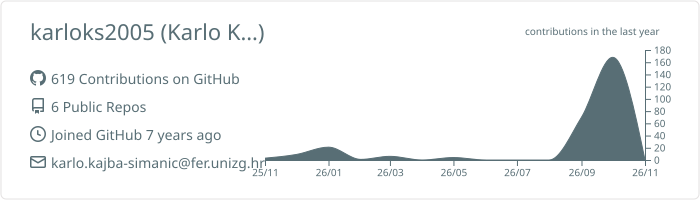
</picture>

  <picture>
    <source media="(prefers-color-scheme: dark)" srcset="./profile-summary-card-output/github_dark/3-stats.svg">
    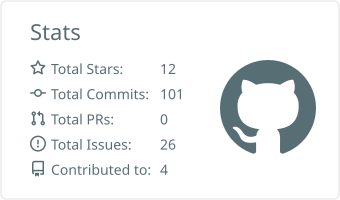
  </picture>
  <picture>
    <source media="(prefers-color-scheme: dark)" srcset="./profile-summary-card-output/github_dark/2-most-commit-language.svg">
    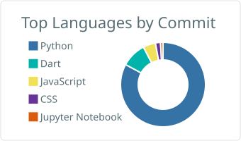
  </picture>

  <picture>
    <source media="(prefers-color-scheme: dark)" srcset="./profile-summary-card-output/github_dark/1-repos-per-language.svg">
    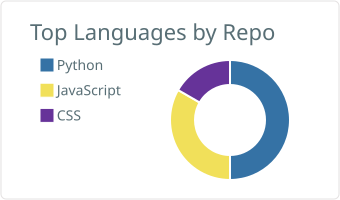
  </picture>
  <picture>
    <source media="(prefers-color-scheme: dark)" srcset="./profile-summary-card-output/github_dark/4-productive-time.svg">
    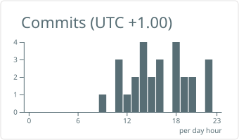
  </picture>

---

### `~/contributions`

<!-- Star map of the contribution calendar, re-rendered every hour by .github/workflows/star-heatmap.yml -->

---

<code>"How do we maintain power, forever, over entities that will eventually become more powerful than us?" — Stuart Russell</code>

  

